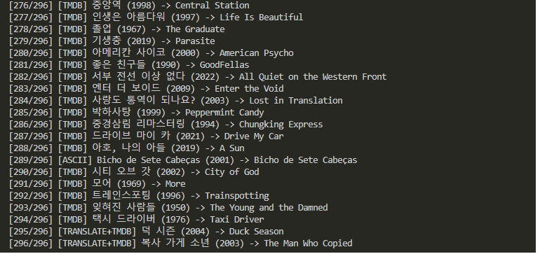
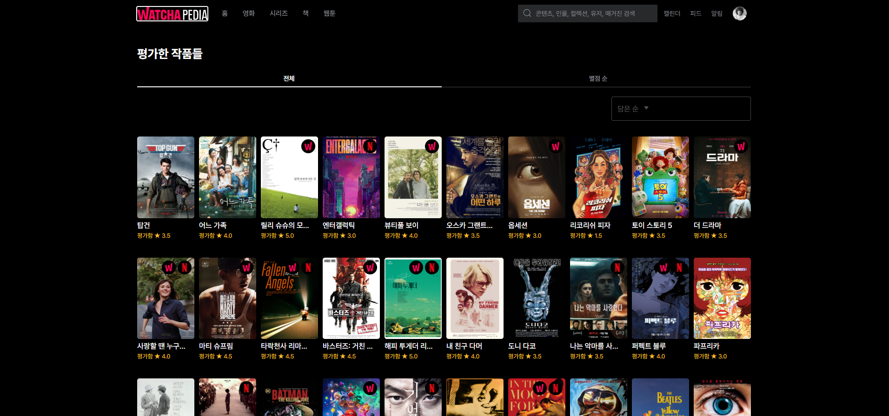
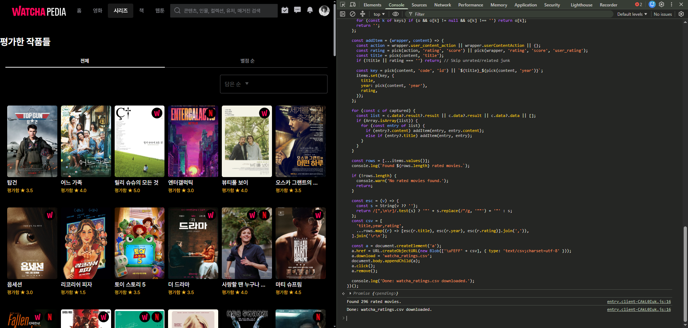

# 🎬 왓챠피디아(Watcha Pedia) 별점 추출 및 영문 제목 변환기

[English](README.md)

**왓챠피디아**(`pedia.watcha.com`)에 기록한 영화 별점을 깔끔한 CSV(`title,year,rating`)로 추출하고, 한국어 개봉명을 공식 영문 제목으로 자동 변환해 주는 도구입니다. **외부 Python 라이브러리 설치가 전혀 필요 없으며**, 특정 영화 제목을 하드코딩하지 않고 알고리즘으로 매칭합니다.



## 주요 기능

- **브라우저 콘솔 원클릭 추출:** 왓챠피디아 내부 페이지네이션 API를 가로채어 별점을 매긴 영화(`title,year,rating`)만 정확히 `watcha_ratings.csv`로 다운로드합니다.
- **다운로드 폴더 자동 인식:** `translate_titles.py` 실행 시 현재 폴더 또는 `Downloads`(다운로드) 폴더에서 가장 최신 `watcha_ratings*.csv` 파일을 자동으로 찾아 처리합니다.
- **4단계 자동 제목 매칭 파이프라인 (하드코딩 없음):**
  1. **TMDB 1차 검색 (`ko-KR` + 개봉 연도):** `리마스터링`, `감독판`, `4K`, `재개봉` 등의 부가 표기를 자동 제거한 뒤 개봉 연도 기준으로 매칭합니다.
  2. **TMDB 광역 검색 (`region=KR`):** 한국어 현지화 데이터가 누락된 작품의 글로벌 별칭(Alternative Titles)을 ±2년 범위로 검색합니다.
  3. **Wikidata 검증 한국어 위키백과 검색:** 한국어 위키백과 검색 결과를 Wikidata의 `P31`(인스턴스 유형: 영화/단편/TV 영화) 속성으로 교차 검증하여 동명이인 배우나 동음이의어 문서로 잘못 매칭되는 문제를 원천 차단합니다.
  4. **번역 + 한글 자모 음차 변환 + 어간 확장:** 앞선 단계에서 찾지 못한 해외 영화제·인디 작품은 영문 번역과 유니코드 한글 자모 분해 기반 음차 표기(예: `수퍼배드` → *Superbad*), 영어 단어 어형 변화(`Copy` → `Copied`, *The Man Who Copied*)를 생성해 TMDB의 해당 연도 작품 중 투표수(`vote_count`) 기준으로 최적의 영문 원제를 찾아냅니다.
- **표준 라이브러리만 사용:** Python 기본 내장 모듈(`urllib`, `concurrent.futures`, `csv`)과 8개 병렬 스레드만으로 동작하여 약 300편 기준 10초 이내에 변환을 완료합니다.

## 1단계: 왓챠피디아에서 별점 데이터 추출하기

1. [왓챠피디아](https://pedia.watcha.com)에 로그인한 뒤 내 프로필의 평가한 영화 목록(**보관함 → 영화 → 평가한 작품**)으로 이동합니다.

   

2. 브라우저 개발자 도구 콘솔(`F12` 또는 `Ctrl+Shift+J` / `Cmd+Option+J`)을 열고 [`export_watcha.js`](export_watcha.js)의 전체 코드를 붙여넣은 뒤 **Enter**를 누릅니다.
   > **참고:** Chrome, Edge 등 Chromium 기반 브라우저에서는 보안상 콘솔 붙여넣기가 처음에 차단될 수 있습니다. 경고 문구가 나타나면 `allow pasting`을 입력하고 **Enter**를 누른 뒤 스크립트를 붙여넣으세요.

   

3. 스크립트가 자동으로 페이지를 스크롤해 인증 정보를 확보한 뒤 모든 평가 내역을 수집하여 `Downloads` 폴더에 `watcha_ratings.csv`를 저장합니다.

## 2단계: 한국어 영화 제목을 영문 제목으로 변환하기 (선택 사항)

**Python 3.10 이상**과 무료 **TMDB v3 API 키**([TMDB 계정 설정 → API](https://www.themoviedb.org/settings/api)에서 발급 가능)가 필요합니다.

1. 저장소를 클론합니다:
   ```bash
   git clone https://github.com/mtz-lorenzo/watcha-pedia-exporter.git
   cd watcha-pedia-exporter
   ```

2. 프로젝트 루트 폴더에 `.env` 파일을 생성하고 발급받은 TMDB API 키를 입력합니다:
   ```env
   TMDB_API_KEY=여기에_TMDB_v3_API_키_입력
   ```

3. 변환 스크립트를 실행합니다:
   ```bash
   python translate_titles.py
   ```

`Downloads` 폴더에 있는 `watcha_ratings.csv`를 자동으로 불러와 프로젝트 폴더 내에 `watcha_ratings_english.csv` 파일을 생성합니다. 생성된 파일은 **Letterboxd**, **IMDb** 등에 바로 가져올 수 있습니다.

## 제목 변환 알고리즘 구조

한국 극장 개봉명이나 왓챠 등록 제목이 영문 원제와 다른 경우(완전 개명, 외래어 표기 차이, 해외 영화제 작품의 한국어 직역 등)를 처리하기 위해 다음 4단계를 순차적으로 실행합니다:

| 단계 | 로그 태그 | 매칭 방식 | 변환 예시 |
|------|-----------|-----------|-----------|
| 1 | `[TMDB]` | 부가 표기 제거 후 한국어 제목(`ko-KR`) + 개봉 연도(±1년) 검색 | `기생충 (2019)` → *Parasite* |
| 2 | `[TMDB-BROAD]` | `region=KR` 기준 글로벌 별칭 및 띄어쓰기 변형 검색(±2년) | `바니 버디 (2011)` → *Hop* |
| 3 | `[WIKI]` | 한국어 위키백과 검색 후 Wikidata `P31` 영화 엔티티 검증 | `광견 쿠조 (1983)` → *Cujo* |
| 4 | `[TRANSLATE+TMDB]` | 영문 번역 + 한글 자모 음차 변환 + 어형 변화 후보군을 연도별 TMDB 검색 후 `vote_count` 순 정렬 | `수퍼배드 (2007)` → *Superbad*<br>`복사 가게 소년 (2003)` → *The Man Who Copied* |

## 프로젝트 구조

```text
watcha-pedia-exporter/
├── export_watcha.js        # 왓챠피디아 별점 추출용 브라우저 콘솔 스크립트
├── translate_titles.py     # 4단계 영문 제목 변환 스크립트 (TMDB + Wikidata + 음차 변환)
├── .env.example            # TMDB_API_KEY 설정 예시 파일
├── .gitignore              # .env 및 개인 기록(*.csv) 업로드 방지
├── docs/                   # README 스크린샷 폴더
├── README.md               # 영문 설명서
└── README.ko.md            # 한국어 설명서
```

## 제한 사항

- **영화 전용:** `translate_titles.py`는 TMDB의 영화 검색(`/search/movie`) 엔드포인트를 사용합니다. TV 시리즈 별점을 추출한 경우 일부 시리즈 제목은 직역으로 처리될 수 있습니다.
- **API 호출 제한:** 4단계 번역 API(MyMemory)는 1~3단계에서 찾지 못한 약 2~3%의 예외 작품에만 호출되므로 무료 일일 한도 내에서 안정적으로 동작합니다.
- **별점 체계:** 왓챠피디아의 `0.5`~`5.0` 단위 별점이 그대로 유지되므로 Letterboxd CSV 가져오기 형식과 바로 호환됩니다.

## 라이선스

MIT 라이선스를 따릅니다. 자세한 내용은 [LICENSE](LICENSE)를 참고하세요.