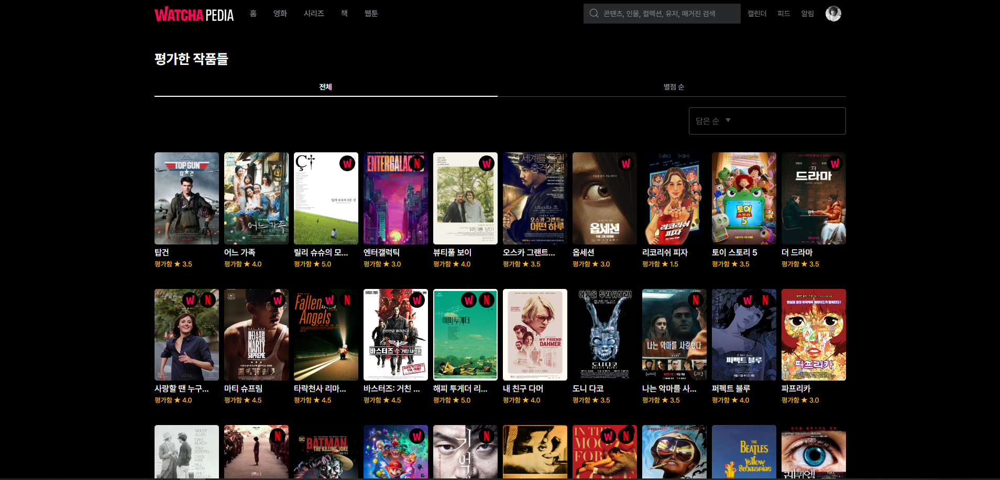
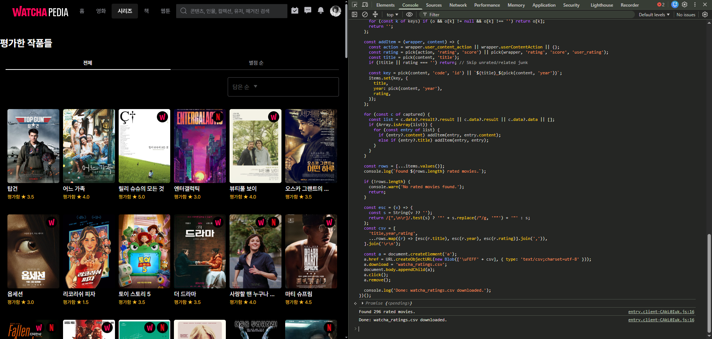
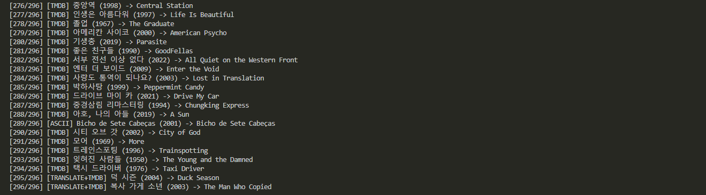

# 🎬 Watcha Pedia Ratings Exporter & Title Resolver

[한국어](README.ko.md)

Export your movie ratings from **Watcha Pedia** (`pedia.watcha.com`) to a clean CSV (`title,year,rating`) and automatically resolve Korean localized titles to their official English release titles—with **zero external Python dependencies** and **zero hardcoded movie dictionaries**.

## Features

- **One-click browser extraction.** Captures Watcha Pedia's internal pagination API directly from your browser session and downloads `watcha_ratings.csv` (`title,year,rating`), ignoring unrated items and recommendation clutter.
- **Automatic Downloads detection.** `translate_titles.py` automatically finds the latest `watcha_ratings*.csv` in either the project folder or your `Downloads` directory—no manual file moving required.
- **4-tier resolution pipeline (zero hardcoding):**
  1. **Primary TMDB lookup (`ko-KR` + release year):** Strips Watcha edition tags (`리마스터링`, `감독판`, `4K`, `재개봉`, etc.) and matches exact release years.
  2. **Broad TMDB lookup (`region=KR`):** Searches global and alternative title aliases across a ±2 year window.
  3. **Wikidata-verified Korean Wikipedia:** Queries Korean Wikipedia and strictly verifies entity type via Wikidata `P31` (film/short/TV movie) so actor biographies and disambiguation pages never cause false positives.
  4. **Translation + Unicode Hangul romanization + morphological stemming:** Translates unresolved titles, generates algorithmic Jamo phonetic romanizations (catching Korean loanword spellings like `수퍼배드` → *Superbad*), expands English word stems (`Copy` → `Copied` for *The Man Who Copied*), and ranks year-matched TMDB candidates by vote count.
- **Fast & stdlib-only.** Uses Python's standard library (`urllib`, `concurrent.futures`, `csv`) with 8 worker threads—resolving ~300 movies in under 10 seconds with no `pip install` required.

## Step 1: Export ratings from Watcha Pedia

1. Log in to [Watcha Pedia](https://pedia.watcha.com) and go to your profile's rated movies page (**보관함 → 영화 → 평가한 작품**).

   

2. Open your browser's Developer Console (`F12` or `Ctrl+Shift+J` / `Cmd+Option+J`), paste the contents of [`export_watcha.js`](export_watcha.js), and press **Enter**.
   > **Note:** Chromium-based browsers (Chrome, Edge, Brave) block pasting into the console for the first time as a security precaution. If prompted, type `allow pasting` and press **Enter**, then paste the script.

   

3. The script will scroll once to capture the session token, paginate through all your rated movies, and automatically download `watcha_ratings.csv` to your `Downloads` folder.

## Step 2: Resolve Korean titles to English (Optional)

Requires **Python 3.10+** and a free **TMDB v3 API key** (available in your [TMDB Account Settings](https://www.themoviedb.org/settings/api)).

1. Clone the repository:
   ```bash
   git clone https://github.com/mtz-lorenzo/watcha-pedia-exporter.git
   cd watcha-pedia-exporter
   ```

2. Create a `.env` file in the project root with your TMDB API key:
   ```env
   TMDB_API_KEY=your_tmdb_v3_api_key_here
   ```

3. Run the resolver:
   ```bash
   python translate_titles.py
   ```



It will automatically locate `watcha_ratings.csv` in your `Downloads` folder and generate `watcha_ratings_english.csv` in the project directory—ready to import into **Letterboxd**, **IMDb**, or any spreadsheet tool.

## How title resolution works

Korean theatrical releases frequently differ from their English titles—either through complete renames (*Hop* → `바니 버디`), loanword transliterations (*Superbad* → `수퍼배드`), or Korean translations of foreign festival titles (*O Homem Que Copiava* → `복사 가게 소년`). Each non-ASCII title cascades through four stages until a verified match is found:

| Tier | Tag | Strategy | Example |
|------|-----|----------|---------|
| 1 | `[TMDB]` | Cleaned Korean query (`ko-KR`) + release year (±1 yr) | `기생충 (2019)` → *Parasite* |
| 2 | `[TMDB-BROAD]` | Global alias search with `region=KR` (±2 yr) | `바니 버디 (2011)` → *Hop* |
| 3 | `[WIKI]` | Korean Wikipedia search verified by Wikidata `P31` film classes | `광견 쿠조 (1983)` → *Cujo* |
| 4 | `[TRANSLATE+TMDB]` | Machine translation + Hangul Jamo romanization + morphological stemming, pooled by year & ranked by TMDB `vote_count` | `수퍼배드 (2007)` → *Superbad*<br>`복사 가게 소년 (2003)` → *The Man Who Copied* |

## Project structure

```text
watcha-pedia-exporter/
├── export_watcha.js        # Browser console script to export Watcha Pedia ratings
├── translate_titles.py     # Multi-tier title resolver (TMDB + Wikidata + phonetics)
├── .env.example            # Template for TMDB_API_KEY
├── .gitignore              # Ignores .env and personal *.csv files
├── docs/                   # README screenshots
├── README.md               # English documentation
└── README.ko.md            # Korean documentation
```

## Known limitations

- **Movies only:** `translate_titles.py` queries TMDB's `/search/movie` endpoint. If you export TV series ratings from Watcha Pedia, series titles may fall back to literal translations unless queried against `/search/tv`.
- **Rate limits:** The public MyMemory translation fallback (Tier 4) is only triggered for the ~2–3% of obscure titles missed by Tiers 1–3, keeping daily request volume well within anonymous limits.
- **Rating scale:** Watcha Pedia exports ratings on its native `0.5`–`5.0` scale (compatible directly with Letterboxd CSV imports).

## License

MIT. See [LICENSE](LICENSE).